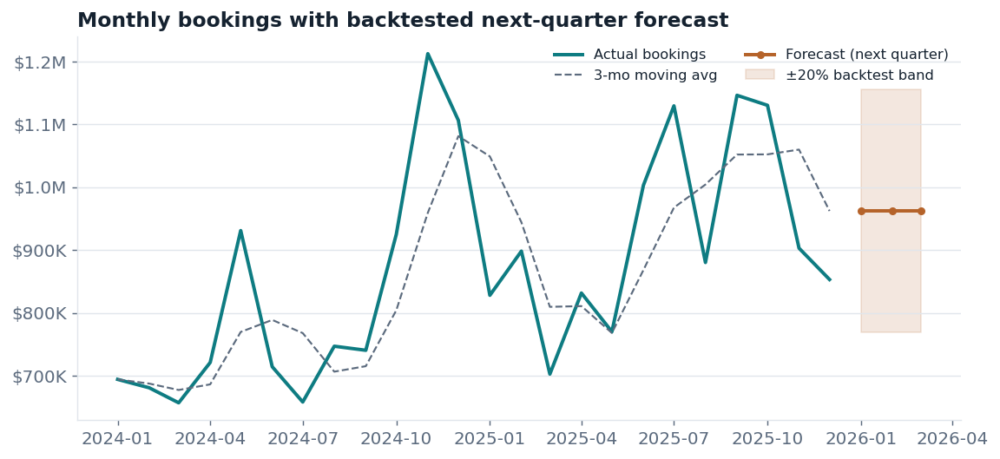
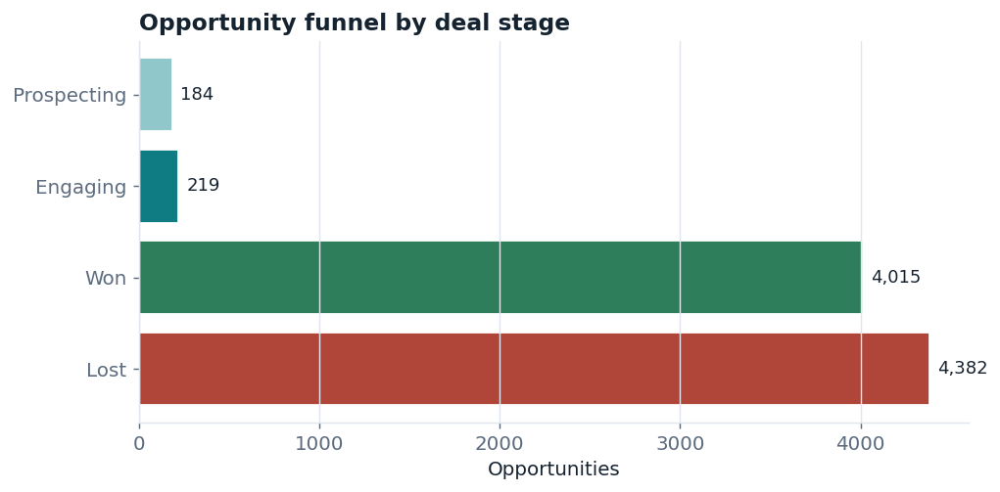
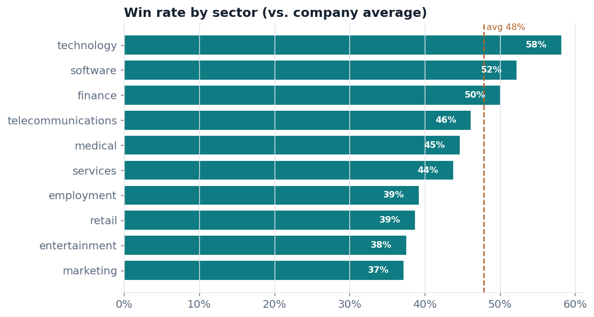
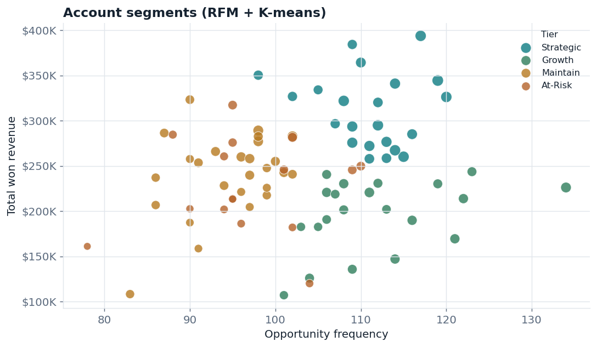
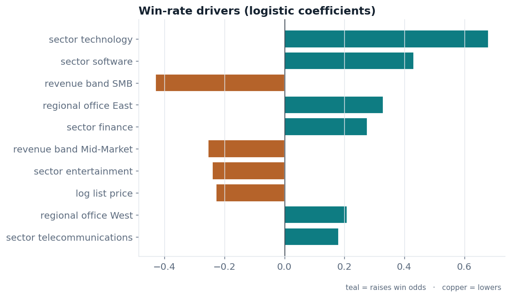

# Pipeline IQ — B2B Revenue & CRM Analytics

> End-to-end sales analytics on **8,800 CRM opportunities**: a SQL data model, RFM + K-means account segmentation, a **backtested revenue forecast**, and a win-driver model — surfaced in an executive dashboard with prioritized, dollar-quantified recommendations.



<p>


</p>

**The business question:** *Which segments, reps, and deals should the sales org double down on next quarter — and what revenue will we actually close?*

---

## Headline findings

| Metric | Result |
|---|---|
| Total closed-won revenue | **$20.9M** across 8,397 closed deals |
| Overall win rate | **47.8%** |
| Best vs. worst sector win rate | **Technology 58.3%** vs. **Marketing 37.3%** — a **21-point** gap |
| Revenue concentration | Top **20%** of accounts drive **~27%** of revenue |
| Avg. sales cycle | **43.6 days** |
| Next-quarter bookings forecast | **$2.89M**, validated at **20.1% MAPE** (walk-forward backtest) |
| Open weighted pipeline | **$0.79M** |
| Win-driver model | Cross-validated **ROC-AUC 0.60** |

> **Recommendation in one line:** reallocate prospecting capacity from Marketing/Entertainment toward Technology, Software, and Enterprise-tier accounts — the win-driver model shows these lift win odds most — and protect the 27% of revenue concentrated in the top-tier accounts with named coverage.

See the full [recommendation memo →](reports/recommendation_memo.md)

---

## What this project demonstrates

- **SQL data modeling** — a layered warehouse (staging → marts) built in DuckDB with CTEs, window functions, and a star schema (`fct_pipeline` + `dim_account`).
- **Customer segmentation** — RFM scoring adapted to B2B, clustered with K-means (k chosen by silhouette score) into Strategic / Growth / Maintain / At-Risk tiers.
- **Forecasting with honest validation** — two transparent models compared via **rolling-origin backtest**; the winner and its out-of-sample error drive the forecast band.
- **Explanatory modeling** — a logistic win/loss model that ranks the real drivers of win rate (sector, deal size, account tier, region).
- **BI delivery** — a Power BI-ready star-schema export and a 3-page executive dashboard spec.

---

## Architecture

```
  data/raw/*.csv                4 relational CSVs (Maven CRM schema)
        │
        ▼
  DuckDB warehouse ── sql/staging/ (clean, type-cast, derive)
        │             sql/marts/   (fct_pipeline, dim_account, kpi_*)
        ▼
  Python analytics ── segmentation.py   RFM + K-means tiers
                      forecast.py       backtested bookings forecast
                      drivers.py        logistic win-driver model
        │
        ▼
  Outputs ── assets/*.png     charts (README + memo)
             data/exports/    segments, forecast, Power BI star schema
             reports/         metrics.json + recommendation memo
```

## Results gallery

| Pipeline funnel | Win rate by sector |
|---|---|
|  |  |

| Account segments (RFM + K-means) | Win-rate drivers |
|---|---|
|  |  |

---

## Quickstart

```bash
# 1. create the environment
python3 -m venv .venv && source .venv/bin/activate
pip install -r requirements.txt

# 2. run the whole project (data → warehouse → models → charts → exports)
python src/run_all.py
```

That single command regenerates the dataset, builds the DuckDB warehouse, runs
every model, writes all six charts to `assets/`, exports the Power BI star schema,
and refreshes `reports/metrics.json`. Run individual stages with:

```bash
python src/generate_data.py     # build the raw CSVs
python src/etl.py               # build the SQL warehouse
python src/segmentation.py      # account tiers
python src/forecast.py          # backtested forecast + method comparison
python src/drivers.py           # win-driver model
```

## Data

This repo ships with a **realistic synthetic dataset** (`src/generate_data.py`)
that mirrors the schema of the free **[Maven Analytics "CRM Sales Opportunities"](https://www.mavenanalytics.io/data-playground)**
dataset — four relational tables (`sales_pipeline`, `accounts`, `products`,
`sales_teams`). It intentionally bakes in learnable structure (win rate varies by
sector, rep, deal size, and account tier) so the analytics recover defensible
patterns. **To run on the real data instead**, download the four Maven CSVs into
`data/raw/` and skip `generate_data.py` — every downstream step reads the same
file and column names.

## Repository structure

```
pipeline-iq/
├─ README.md
├─ requirements.txt
├─ data/
│  ├─ raw/            # 4 source CSVs
│  └─ exports/        # segments, forecast, Power BI star schema
├─ sql/
│  ├─ staging/        # stg_accounts, stg_pipeline (clean views)
│  └─ marts/          # fct_pipeline, dim_account, kpi_* (analytics views)
├─ src/
│  ├─ generate_data.py
│  ├─ etl.py          # loads CSVs → DuckDB, runs SQL layer
│  ├─ segmentation.py # RFM + K-means
│  ├─ forecast.py     # backtested bookings forecast
│  ├─ drivers.py      # logistic win-driver model
│  ├─ viz.py          # chart rendering
│  └─ run_all.py      # one-command reproduce
├─ notebooks/         # analysis walkthrough
├─ powerbi/           # dashboard build guide + DAX measures
├─ reports/           # metrics.json + recommendation memo
└─ assets/            # exported charts
```

## Tech stack

**Python** (pandas, numpy, scikit-learn, matplotlib) · **SQL** (DuckDB) · **Power BI** · isolated `venv`.

## Notes & limitations

- The headline numbers are computed from the shipped dataset and refresh whenever
  `run_all.py` runs; they match exactly what the script prints.
- The forecast deliberately favors transparent, backtestable methods over
  black-box models, which suits a ~24-month monthly series where the backtest
  needs to be trustworthy.
- Point it at real Maven (or a Salesforce/HubSpot export) CSVs for a live read.
